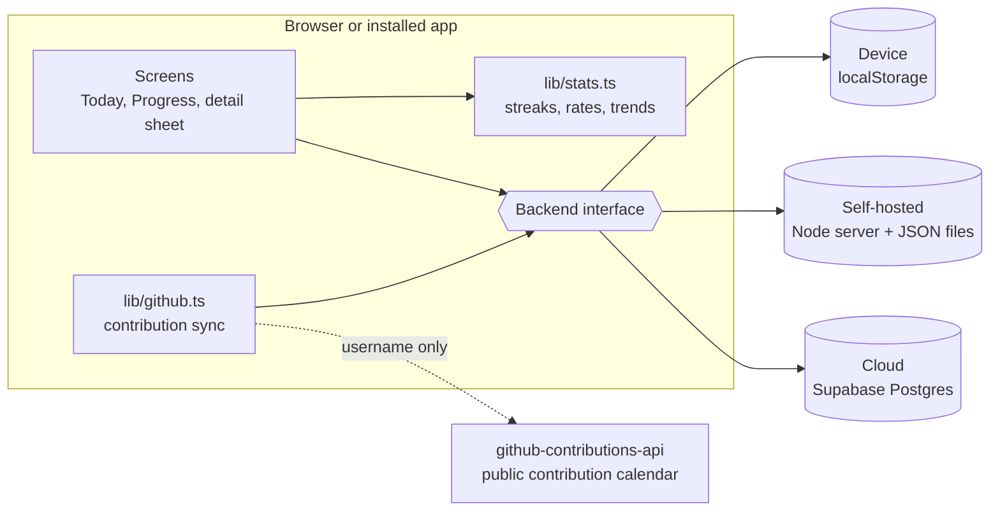
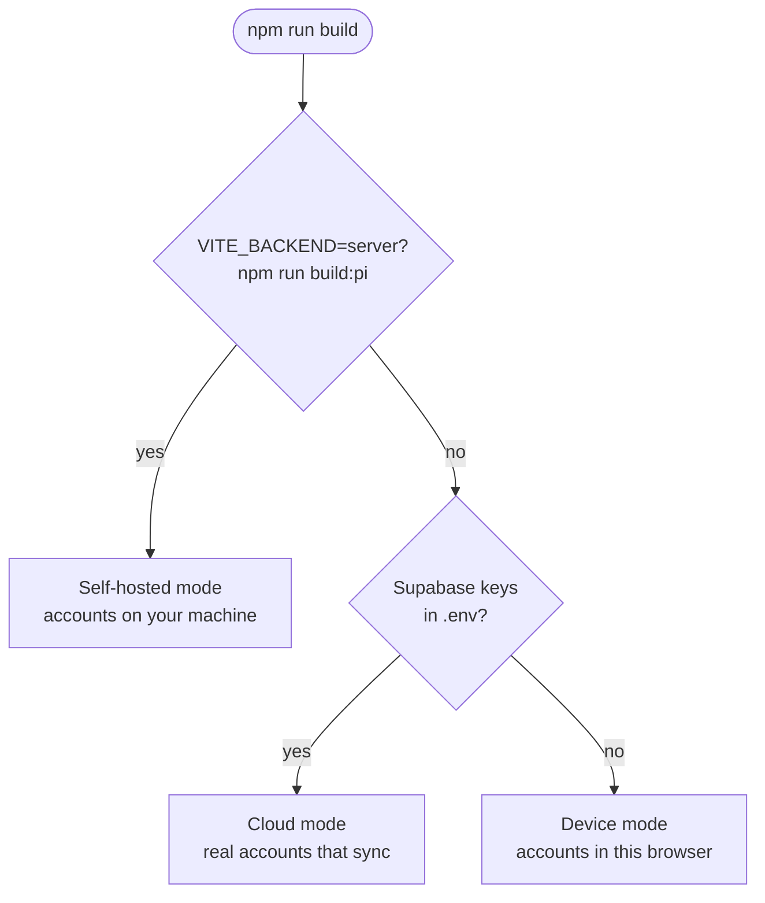
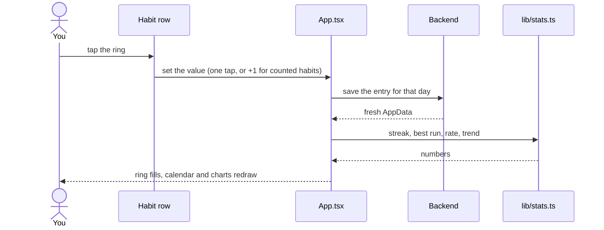
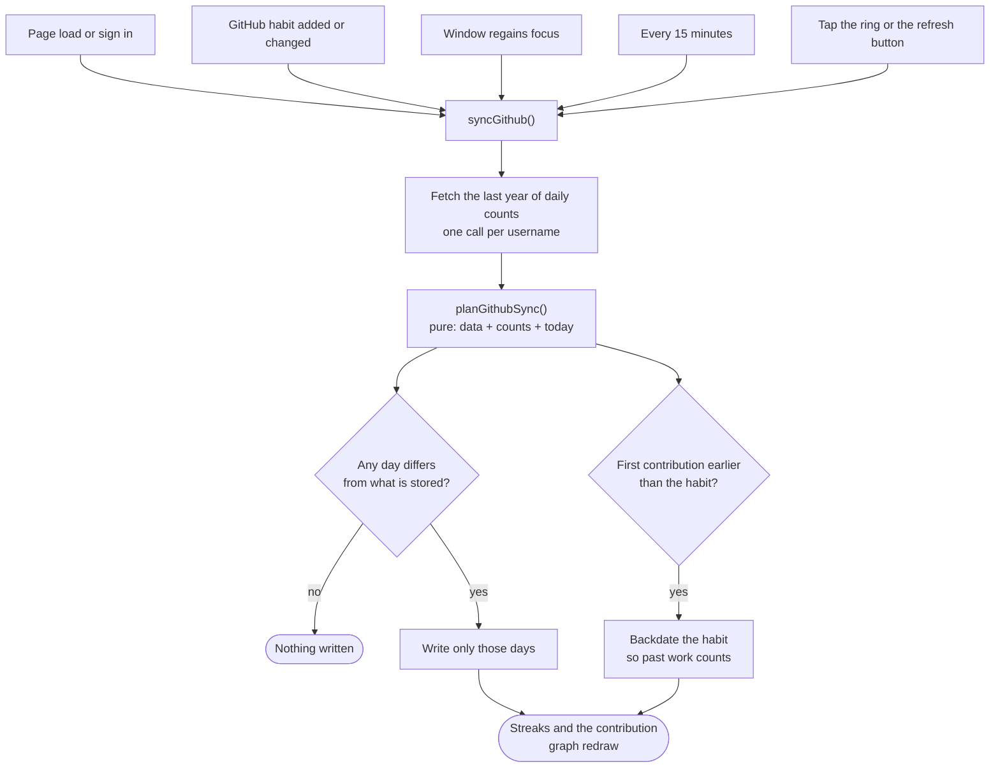
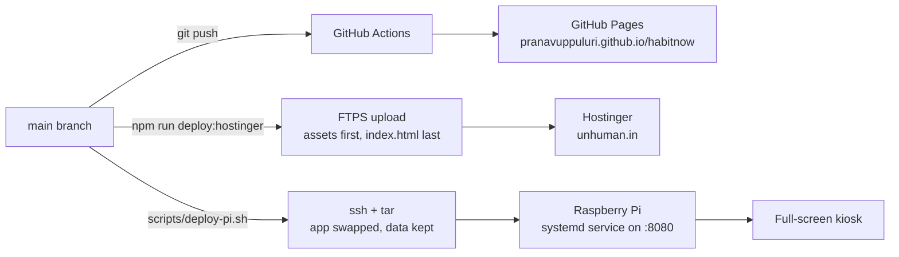

# HabitNow

A habit tracker in the browser. Check habits off day by day, grouped by time of
day, and watch each streak build. Free to host end to end.

- **Today** — habits grouped into morning / afternoon / evening / any time, with
  a ring you tap to check off. Counted habits (8 glasses of water) fill the ring
  a tap at a time. Drag rows to reorder them.
- **Streak calendar** — a month grid where an unbroken run is drawn as one
  continuous bar. A streak that carries past Saturday keeps a flush edge and
  resumes flush on the next row, so the only rounded ends in the month are where
  a streak actually started and stopped.
- **Streak thread** — every row carries a bar chart of its last twelve days, so
  gaps are as visible as runs.
- **Day rail** — seven days at a glance, each with a meter of how much of that
  day got finished. Past days are editable; future days are not.
- **Progress** — completion trend over 30 / 90 / 365 days with a seven-day
  average, a day-of-the-week breakdown, a year heatmap, per-habit sparklines,
  and a table of the same numbers. Scope any of it to one habit.
- **Per-habit detail** — current streak, best run, completion rate, the streak
  calendar, a 40-week heatmap, and a note per day.
- **Areas** — group habits into parts of your life and filter the list by one.
- **GitHub habits**: a habit can be tracked by your public GitHub contributions
  instead of ticked by hand. It fills itself in, backdates to your first
  contribution of the year, and draws the same contribution graph as your
  GitHub profile.
- **Reminders** — a per-habit time that fires a local notification while the app
  is open, including a background tab or the installed app.
- **Installable** — add it to a phone home screen or desktop; the service worker
  caches the shell and fonts, so it opens and works with no connection.
- Skip a day (keeps the streak alive without counting toward it), archive a
  habit without losing its history, dark and light themes, keyboard accessible.
- **Phone layout**: a bottom bar with a More menu, sheets that rise from the
  bottom edge, charts that open on the newest weeks, and room left for the
  iPhone home bar.

## How it fits together

### The pieces

Every screen talks to one `Backend` interface. Which implementation sits behind
it is decided once, at build time, so the UI never knows where data lives.



### Which backend a build gets



### Checking a habit off



### Syncing a GitHub habit



### Where it ships



## Colour, and why there are five

The habit palette is five colours rather than the eight this started with,
because eight did not survive testing. Any two habits can sit side by side, so
every pair has to be distinguishable — not just neighbours in a fixed order.
Under that test the original set failed badly: rose and clay sat at ΔE 9.0 for
normal vision, and amber and lime at ΔE 1.4 for a red-green colourblind reader.

Six, seven and eight colours cannot reach the ΔE 6 colourblind floor at all.
Five reaches normal-vision ΔE 18.3 and colourblind ΔE 6.0, which is acceptable
only alongside a second, non-colour channel — and this UI always has one, since a
habit's colour never appears without its name and emoji next to it.
`scripts/pick-palette.mjs` is the search that settled it; dark mode is its own
validated set rather than a flipped copy.

Charts follow from that: anything about **one** habit is a sequential ramp in
that habit's own hue, anything about **all** habits is monochrome, and per-habit
comparison is done with small multiples. No chart ever asks you to tell palette
colours apart.

## Reminders, honestly

Reminders are local notifications scheduled by the open page. They fire while
HabitNow is open — a background tab counts, and so does the installed app — and
they do **not** fire once it is fully closed.

Firing when the app is closed needs a server to send a push message: a service
worker only shows a notification when something wakes it, and nothing on static
hosting does that on a schedule. (The browser API that would have allowed true
offline scheduling never shipped.) So background reminders are a cloud-backend
feature — a scheduled job sending Web Push — and until that exists, this is the
version that does not overpromise.

## Run it locally

```bash
npm install
npm run dev      # start the app
npm test         # streak maths + render smoke tests
npm run build    # type-check, bundle, generate the service worker
npm run icons    # regenerate the PWA icons from scripts/make-icons.mjs
```

Open the URL it prints. Create an account and start adding habits — no server
setup needed for this part.

## The three modes

The app picks its storage at build time. Nothing else changes.

| | Device (default) | Self-hosted | Cloud |
|---|---|---|---|
| Build | `npm run build` | `npm run build:pi` | `npm run build` with Supabase keys |
| Accounts | Stored in this browser | On your own machine (scrypt hashes, HttpOnly cookie) | Real Supabase auth |
| Data | `localStorage` | JSON files, daily backups, last 30 kept | Postgres, per user |
| Syncs across devices | No | Yes, on your network | Yes |
| Setup | None | Node 18+ and one systemd unit | About 10 minutes, free |

Device mode is fully functional, but the account and its habits never leave the
browser they were created in. Clearing site data erases them. Passwords are
salted and hashed rather than stored in the clear, but anything in
`localStorage` is readable by whoever has the device: treat it as a convenience
lock, not security.

## Switch on real accounts (free)

1. Create a project at [supabase.com](https://supabase.com) — the free tier
   covers 50,000 monthly active users and 500 MB of database.
2. In the SQL editor, paste and run [`supabase/schema.sql`](supabase/schema.sql).
   It creates the three tables and the row-level security policies that scope
   every row to its owner.
3. Under **Authentication → Providers → Email**, decide whether to require email
   confirmation. With it on, a new account has to click a link before it can sign
   in. With it off, sign-up logs straight in — easier while you are testing.
4. Copy **Project Settings → API → Project URL** and the **anon public** key
   into a local `.env` file (see `.env.example`):

   ```
   VITE_SUPABASE_URL=https://xxxx.supabase.co
   VITE_SUPABASE_ANON_KEY=eyJ...
   ```

5. Restart `npm run dev`. The sign-in screen now says "Synced account".

The anon key is meant to be public — it ships inside the JavaScript bundle of
every Supabase site. Row-level security, not key secrecy, is what keeps one
person's habits out of another's. Never put the **service role** key in this
project.

## Publish it free on GitHub Pages

No domain and no hosting bill. You get `https://<your-user>.github.io/habitnow`
with HTTPS included.

```bash
git init
git add .
git commit -m "HabitNow"
git branch -M main
git remote add origin https://github.com/<your-user>/habitnow.git
git push -u origin main
```

Then in the repo on GitHub:

1. **Settings → Pages → Build and deployment → Source:** pick **GitHub Actions**.
2. For cloud mode, add the two values under **Settings → Secrets and variables →
   Actions → Variables** (the *Variables* tab, not Secrets — they are baked into
   a public bundle either way, and Variables is the honest place for that):
   `VITE_SUPABASE_URL` and `VITE_SUPABASE_ANON_KEY`. Skip this and the deployed
   site runs in device mode.
3. Push to `main`. [`.github/workflows/deploy.yml`](.github/workflows/deploy.yml)
   lints, tests, builds and publishes on every push; a red check stops the
   deploy. [`ci.yml`](.github/workflows/ci.yml) runs the same checks on pull
   requests. Watch both under **Actions**.

`vite.config.ts` sets `base: './'`, so the same build works at a repo subpath,
at a domain root, or opened from disk — you don't have to edit a config when you
move it.

### Do you need a domain or a host?

No, for either mode:

- **Static files** — GitHub Pages serves them free, forever, on your
  `github.io` subdomain. Netlify and Vercel free tiers work the same way if you
  prefer them.
- **Accounts and data** — Pages can't run server code, which is exactly what
  Supabase's free tier provides. It is a separate service, not a server you rent.

A custom domain (roughly ₹700–1,000/year) is the only thing money buys here, and
it is purely cosmetic: point its DNS at GitHub Pages, tick **Enforce HTTPS**, and
nothing else changes.

## GitHub habits

**New habit → Tracked by → GitHub contributions**, then a username (an
`@handle` or a profile link works too). Each day's value becomes that day's
contribution count, so **Counts as done at** `1` means any contribution keeps
the streak.

- Counts come from `github-contributions-api.jogruber.de`, which reads the
  public contribution calendar and allows browser requests. No token and no
  server, so it works in every mode. Only the username is sent.
- Private work only counts if *Include private contributions* is on in your
  GitHub profile settings, and commits only count when authored with an email
  linked to the account.
- The detail sheet shows the profile-style graph: 53 weeks, five shades set by
  quartile of your own active days like GitHub's, in the habit's colour. New
  GitHub habits default to green.

## Self-host it on a Raspberry Pi

```bash
npm run build:pi          # build with VITE_BACKEND=server into dist-pi/
npm run serve             # try the server locally on :8080
scripts/deploy-pi.sh      # ship to the Pi (set PI=user@host to override)
```

`server/habitnow-server.mjs` has no dependencies: it serves the app and a small
JSON API, writes files atomically, and keeps a dated backup each day.
`server/habitnow.service` runs it under systemd. A deploy swaps the `app/`
folder and never touches `data/`.

## Publish it on your own domain

`npm run deploy:hostinger` builds and uploads `dist/` over FTPS to any host that
gives you FTP access. It reads `FTP_HOST`, `FTP_USER`, `FTP_PASSWORD` and
`FTP_DIR` from the git-ignored `.env.local`, uploads the hashed assets before
`index.html` so a visitor never gets a page whose scripts are missing, then
prunes old bundles. `public/.htaccess` keeps the HTML and service worker
uncached and the hashed assets cached for a year. Pass `-- --no-build` to
upload the existing build.

## Layout

```
src/
  lib/            types, colours, local-date helpers, streak and stats maths
  backend/        one interface, three implementations (device, server, Supabase)
  components/
    charts/       hand-drawn SVG: streak calendar, trend, weekday, year heat,
                  GitHub contribution graph
  test/           render, server, cloud backend and sync tests (jsdom)
server/           zero-dependency Node server and its systemd unit
scripts/          palette search, icons, Pi and Hostinger deploys
supabase/         schema.sql, tables and row-level security
```

Tests cover the streak maths against hand-worked cases, and render the app far
enough to prove every chart draws rather than throwing into an empty panel.

Dates are handled as local-calendar `YYYY-MM-DD` strings throughout, never as
UTC instants, so a check-in at 11pm belongs to the day you were actually living
in.
